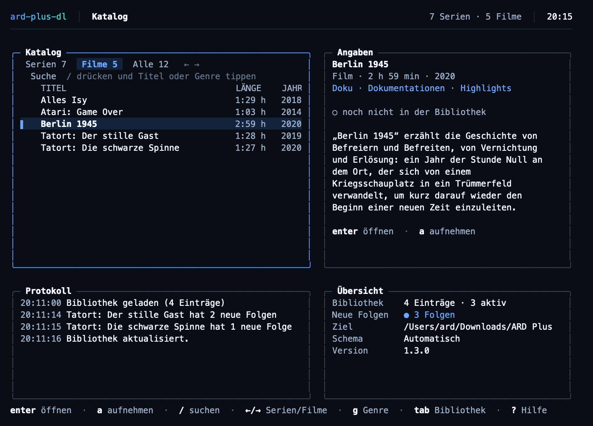
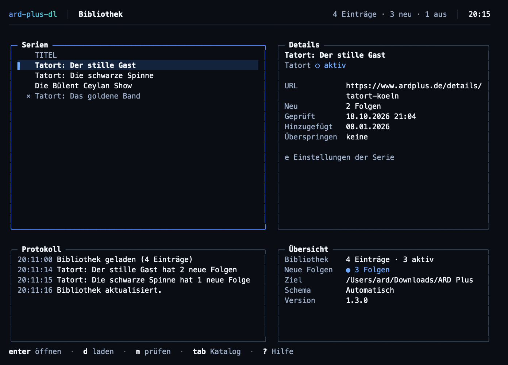
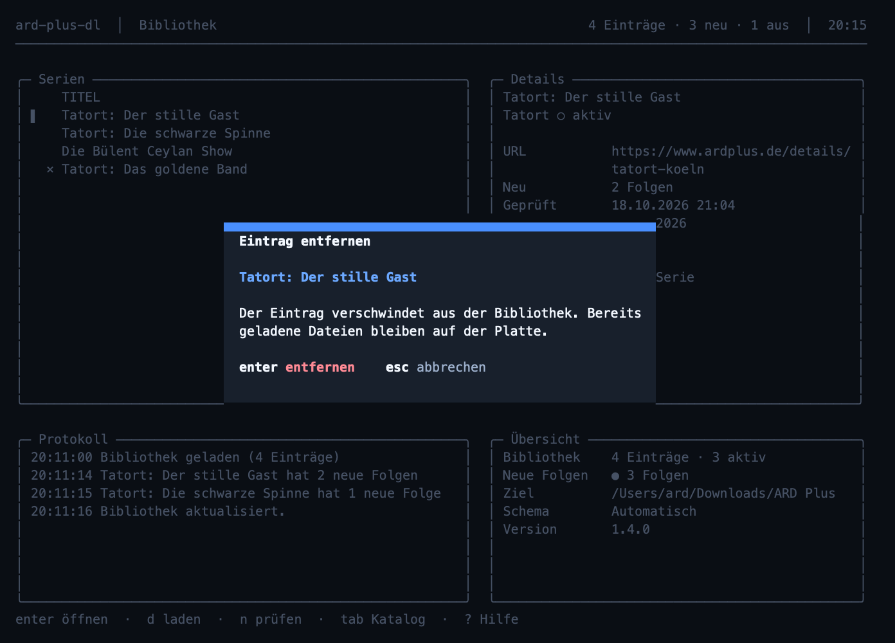
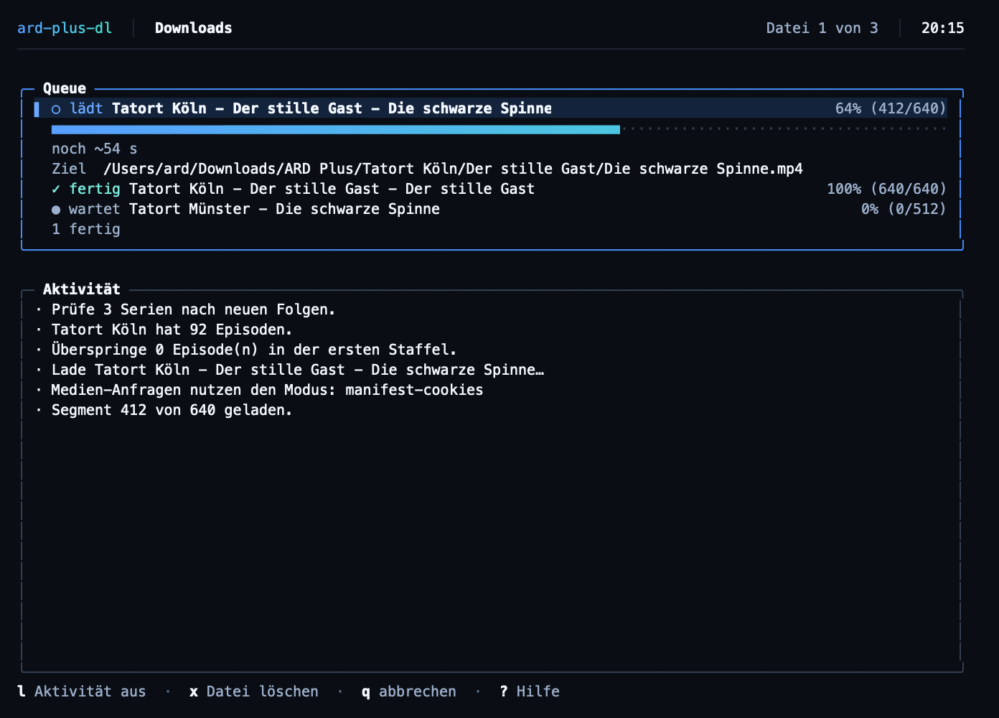
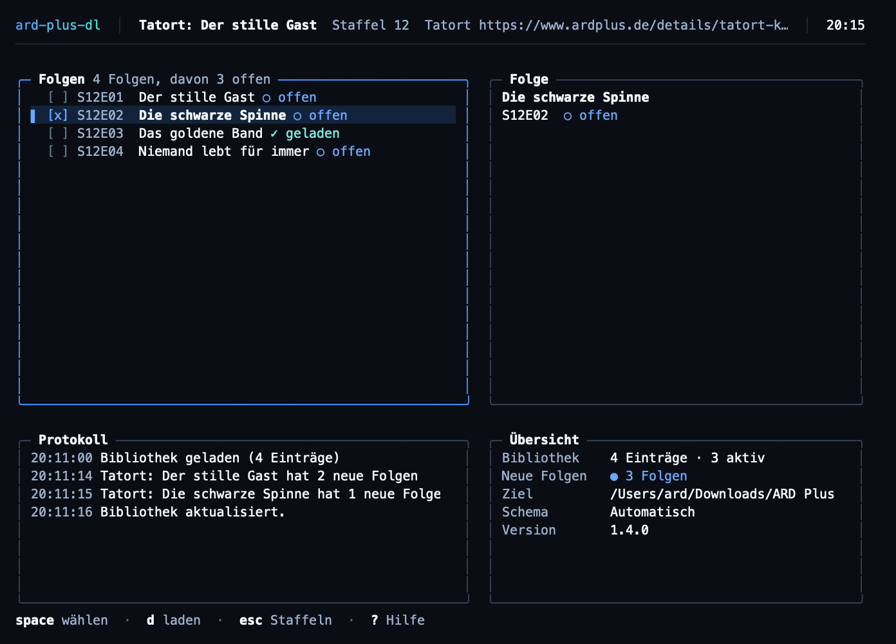
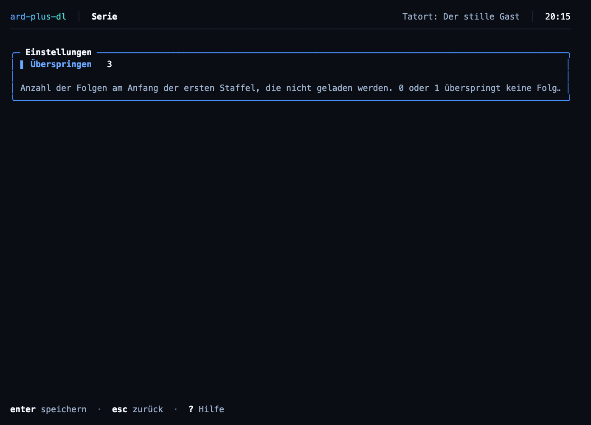
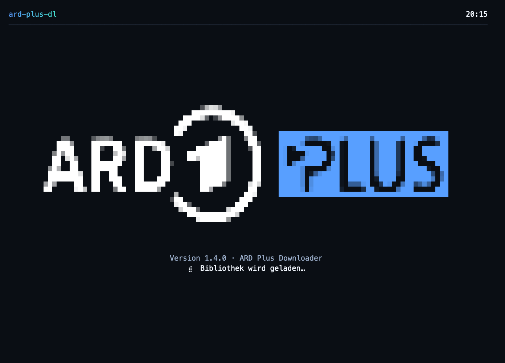
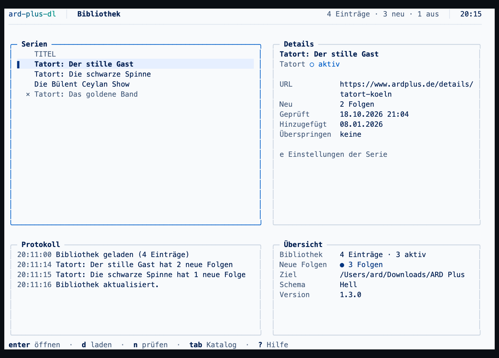

# ard-plus-dl

Hilfswerkzeug für [ARD-Plus-Abonnenten](https://www.ardplus.de/) zur lokalen Archivierung von Filmen, Serien und Tatort-Sammlungen - nur im Rahmen eines gültigen Abos und des geltenden Rechts.

Ein einzelnes Go-Binary für Linux, Windows und macOS mit interaktiver Terminal-Oberfläche (TUI) und identischer Kommandozeile für Automatisierung. Der Downloader spricht DASH selbst (kein yt-dlp); ffmpeg und ffprobe werden nur zum Muxen und Auslesen der Medieninformationen verwendet.

> **Rechtlicher Hinweis:** Nur für die eigene, private Nutzung mit gültigem ARD-Plus-Abo. Keine Weitergabe heruntergeladener Inhalte. Details: [LEGAL.md](LEGAL.md)

## Features

- **Katalog**: alle Serien und alle abrufbaren Filme von ARD Plus direkt in der TUI durchsuchen und mit Genre filtern - keine URLs mehr heraussuchen
- Filme, Serien und Tatort-Kategorien werden automatisch erkannt
- TUI für die interaktive Nutzung: Katalog als Startseite, Staffel- und Folgenauswahl, Fortschritt der laufenden Downloads - ohne eine URL einzugeben
- Headless-Modus für Automatisierung (`--automatic`, `--links-file`, `--force-redownload`)
- Nativer DASH-Downloader mit Segment-Resume, Wiederholversuchen und mehreren Tonspuren
- Untertitel in Deutsch und Englisch, sofern verfügbar
- Einheitliche Dateinamen über ffprobe-Tags
- Vorhandene Dateien werden übersprungen, abgebrochene Downloads fortgesetzt (`--force-redownload` verwirft auch Teil-Downloads)
- Mehrere URLs aus einer Link-Datei - z. B. zum Fortsetzen unterbrochener Jobs
- **Bibliothek**: beliebig viele Serien/Tatort-Kategorien speichern (SQLite) und später erneut prüfen
- **Neue Folgen erkennen**: `--check` bzw. `n` in der TUI vergleicht die aktuelle Episodenliste mit der Historie
- Zugangsdaten werden gemerkt; das Passwort liegt im Schlüsselbund des Systems

## Screenshots

| Katalog (Startseite) | Bibliothek |
|----------------------|------------|
|  |  |

| Entfernen mit Rückfrage | |
|-------------------------|-|
|  | |

| Downloads | |
|-----------|-|
|  | |

| Folgen | Einstellungen der Serie |
|-------|------------------------|
|  |  |

| Startbildschirm | Helles Schema |
|-----------------|---------------|
|  |  |

Die Bilder lassen sich neu erzeugen: `python3 docs/screenshots/render.py`.

## Voraussetzungen

- **ffmpeg und ffprobe** auf dem `PATH` (`ARD_PLUS_FFMPEG` / `ARD_PLUS_FFPROBE` überschreiben die Pfade). Fehlen sie, meldet das Programm `Missing required dependencies: ...`.
- Aktive [ARD-Plus-Mitgliedschaft](https://www.ardplus.de/)

## Installation

Fertige Binaries gibt es auf der [Releases-Seite](https://github.com/revunix/ard-plus-dl/releases) für Linux, macOS und Windows (amd64/arm64). Alternativ:

```bash
go install github.com/revunix/ard-plus-dl/cmd/ard-plus-dl@latest
```

Aus dem Quellbaum:

```bash
git clone https://github.com/revunix/ard-plus-dl.git
cd ard-plus-dl
go build -trimpath -o ard-plus-dl ./cmd/ard-plus-dl
```

## Verwendung

```bash
ard-plus-dl [-h|--help] [-v|--version]
ard-plus-dl [--automatic] [--links-file <datei>] [--force-redownload] <url> [<username> <password>] [skip]
```

Ohne URL startet die TUI und fragt die fehlenden Angaben ab. Optionen müssen vor den Positionsargumenten stehen: Das erste Argument ohne führende `-` beginnt die Positionsliste.

| Option / Parameter | Beschreibung |
|--------------------|--------------|
| `-h`, `--help` | Usage ausgeben und mit Exit 0 beenden; eine unbekannte Option meldet `Unknown option: <arg>` auf stderr und endet mit Exit 1 |
| `-v`, `--version` | Version ausgeben und mit Exit 0 beenden |
| `--automatic` | Alle Staffeln/Episoden ohne Rückfrage verarbeiten |
| `--links-file <datei>` | Mehrere URLs aus Datei (aktiviert `--automatic`) |
| `--force-redownload` | Vorhandene Dateien und Teil-Downloads des Ziels verwerfen und neu laden |
| `url` | ARD-Plus-Übersichtsseite: Film/Serie (`/details/...`), Tatort-Kategorie (`/kategorie/tatort-<stadt>` bzw. kurz `/tatort-<stadt>`) oder das Tatort-Archiv `/tatort`. Andere Hosts oder Pfade werden mit `Invalid URL: <Grund>` und Exit 1 abgelehnt |
| `username`, `password` | Optional: eigene ARD-Plus-Zugangsdaten, beide nötig (siehe [Zugangsdaten](#zugangsdaten)) |
| `skip` | Optional: erste N Episoden der **ersten Staffel** überspringen; `0`/`1` überspringt nichts |
| `--library` | Gespeicherte Serien mit Anzahl neuer Folgen auflisten |
| `--json` | Die Bibliothek als JSON ausgeben (zusammen mit `--library`), für Skripte |
| `--check` | Alle gespeicherten Serien auf neue Folgen prüfen (ohne Download) |
| `--download-new` | Prüfen und die neuen Folgen herunterladen |
| `--add <url>` | Eine Serie/Tatort-Kategorie in die Bibliothek aufnehmen, ohne zu laden |

Jeder normale Download trägt die URL automatisch in die Bibliothek ein.

### TUI

Mit einem Terminal (und ohne `--automatic`/`--links-file`) startet die interaktive Oberfläche mit einem kurzen **Startbildschirm** (Logo, Version, Ladeanzeige) und wechselt dann auf den **Katalog**: Er ist die Startseite und zeigt alle Serien und Filme von ARD Plus. Der Katalog lädt schon, während das Logo steht. Eine URL muss in der TUI nicht mehr eingegeben werden; fehlen beim ersten Start Zugangsdaten, fragt ein Formular nur danach. Die TUI benötigt mindestens 40x12 Zeichen. Lange Listen scrollen; ober- und unterhalb des sichtbaren Ausschnitts zeigt `… N weitere` die Anzahl der verborgenen Zeilen.

**Erscheinungsbild**: In den Einstellungen (`s` im Katalog oder in der Bibliothek) lässt sich zwischen *Hell*, *Dunkel* und *Automatisch* wählen (`h`, `d`, `t`; mit `tab` bis zur Zeile „Erscheinungsbild“ blättern). Die Wahl wird gespeichert und beim nächsten Start wiederhergestellt. *Automatisch* erkennt die Hintergrundfarbe des Terminals und nimmt das passende Schema; *Hell* und *Dunkel* legen es fest. Jedes Schema malt die Oberfläche komplett in seinen Farben – inklusive Hintergrund –, damit die Ansicht unabhängig vom Terminal gleich aussieht.

Die Oberfläche ist in Kästen aufgebaut: eine Kopfzeile mit Programmname, Titel der Ansicht, Kontext und Uhrzeit, darunter die Inhalte in Kästen mit dünnem, abgerundetem Rahmen und dem Titel in der oberen Linie, unten eine Fußzeile mit fetten Tasten und gedämpften Beschreibungen. Der Kasten, in dem die Tasten wirken, trägt einen Rahmen in ARD-Blau, die übrigen treten in ruhigem Grau zurück; nebeneinanderstehende Kästen sind gleich hoch. Der markierte Eintrag hat links einen blauen Balken und eine Hintergrundfläche über die ganze Zeile. Die Hilfe öffnet sich als Fenster über der Seite, die dahinter abgeblendet wird. Ab 24 Zeilen Höhe stehen unter den Listen zwei weitere Kästen wie bei btop: das *Protokoll* mit den Meldungen der Sitzung samt Uhrzeit und die *Übersicht* mit Bibliothek, neuen Folgen, Download-Ziel, Erscheinungsbild und Version. Ab 60 Spalten bleibt links und rechts eine Spalte Rand frei. Beim Start zeigt der Splash das ARD-Plus-Logo der Website (weißes „ARD“ mit der „1“, blaue „PLUS“-Box), aus Halbblock-Pixeln gezeichnet und an die Größe des Terminals angepasst; im hellen Schema wird das Weiß zum ARD-Dunkelblau. Währenddessen werden Bibliothek und Katalog geladen.

Die Oberfläche passt sich dem Terminal an: Kopfzeile, Trennlinien und Fußzeile nutzen die volle Breite, der Inhalt füllt die volle Höhe und die Tastenhinweise stehen immer auf der letzten Zeile. Listen bekommen genau so viele Zeilen, wie zwischen Kopfzeile, Kasten und Fußzeile Platz ist. Läuft der Text, wird er umbrochen statt abgeschnitten.

Läuft gerade eine Aktion, zeigt die Kopfzeile einen Spinner mit dem aktuellen Schritt. Das Ergebnis der letzten Aktion erscheint als Kurzmeldung über den Tastenhinweisen und verschwindet, sobald weitergearbeitet wird. Leere Ansichten nennen die Taste, die weiterführt, und Inhalte, die noch geladen werden, zeigen Platzhalterzeilen.

Ab 92 Spalten Breite zeigen die Listen einen zweiten Bereich neben sich: in der Bibliothek die Angaben zum markierten Eintrag, in der Staffel- und Folgenliste die Angaben zur markierten Staffel beziehungsweise Folge. Schmalere Terminals bleiben einspaltig. Die Download-Ansicht listet alle Dateien in einem Queue-Kasten, die laufende Datei mit einem Fortschrittsbalken über die volle Breite; `l` blendet das Aktivitätsprotokoll ein oder aus.

Die Fußzeile zeigt nur die wichtigsten Tasten des aktuellen Bildschirms. `?` blendet ein **Hilfe-Fenster** ein, das über der Seite liegt und alle Tasten des Bildschirms auflistet; jede andere Taste schließt es wieder. `ctrl+c` hat Vorrang und beendet die TUI auch bei offenem Hilfefenster.

1. **Katalog** (Startseite) - alle Serien und alle derzeit abrufbaren Filme von ARD Plus in den Reitern *Serien*, *Filme* und *Alle* (jeweils mit Anzahl der Treffer); links die Liste mit Staffeln bzw. Länge und Jahr, rechts Genres und Beschreibung des markierten Titels; Titel aus der Bibliothek tragen einen Punkt
   - `←`/`→` (oder `1`, `2`, `3`) wechselt zwischen Serien, Filmen und allen Titeln
   - `enter` nimmt den Titel in die Bibliothek auf und öffnet ihn mit Staffeln/Folgen; `esc` führt von dort zurück in den Katalog
   - `a` nimmt den Titel nur in die Bibliothek auf, ohne den Katalog zu verlassen
   - Die Suchzeile steht immer über der Liste: `/` springt hinein, gesucht wird in Titel und Genre, die Wörter in beliebiger Reihenfolge (z. B. „tatort köln“); die Suche gilt für alle Reiter. `g`/`G` schaltet durch die häufigsten Genres, `esc` löscht Suche und Genre
   - `y` kopiert die URL, `r` lädt den Katalog neu, `s` Einstellungen, `tab` zur Bibliothek, `q` beenden
2. **Bibliothek** (`tab` aus dem Katalog) - die aufgenommenen Serien und Filme mit Anzahl neuer Folgen
   - `enter` öffnet den Eintrag und aktualisiert Staffeln/Folgen; `d` lädt neue Folgen und öffnet die Download-Ansicht, `n` prüft alle Einträge
   - `/` sucht in der Bibliothek (Titel oder URL), `esc` löscht den Filter
   - `m` markiert Einträge; markierte Einträge lassen sich gemeinsam entfernen (`x`)
   - `r` setzt die markierte Serie zurück: die heruntergeladenen Dateien werden gelöscht und der Verlauf geleert, sodass alle Folgen wieder angeboten werden
   - `e` öffnet die Einstellungen der markierten Serie: die Anzahl der zu überspringenden Episoden (`0` oder `1` überspringt keine)
   - `y` kopiert die URL in die Zwischenablage
   - `space` aktivieren/deaktivieren, `x` entfernt den Eintrag nach einer Rückfrage in einem Fenster: `enter` bestätigt, `esc` bricht ab. `r` fragt genauso nach, bevor es Dateien löscht
   - `pgup`/`pgdown` blättern, `home`/`end` springen an den Anfang bzw. ans Ende
   - `tab`, `esc` oder `a` führen in den Katalog, `s` Einstellungen (Benutzer, Passwort, Erscheinungsbild), `q` beenden
3. **Seriendetails** - Staffeln mit Folgenzahl und offenen Folgen
   - `up`/`down` wählen eine Staffel, `pgup`/`pgdown` blättern, `home`/`end` springen an den Anfang bzw. ans Ende
   - `enter` öffnet die Folgenliste, `d` lädt alle offenen Folgen der Staffel
4. **Folgenliste** - Folgen der ausgewählten Staffel mit Status (geladen/offen)
   - `y` kopiert den Titel der markierten Folge in die Zwischenablage
   - `space` wählt einzelne Folgen, `a` alle/keine, `enter`/`d` lädt die Auswahl. Ohne jede Markierung werden alle offenen Folgen der Staffel geladen; nach einer Abwahl werden nur die markierten geladen, bei keiner Markierung keine
   - `pgup`/`pgdown` blättern, `home`/`end` springen an den Anfang bzw. ans Ende
   - `esc` zurück zu den Staffeln; bei Tatort bleibt die Folgenliste flach und `esc` kehrt zur Bibliothek zurück
5. **Anmeldung** - Zugangsdaten eingeben, wenn sie beim Start fehlen (`tab` wechselt das Feld, `enter` speichert und öffnet den Katalog, `esc` zurück); in den Einstellungen zusätzlich das Erscheinungsbild (`h` hell, `d` dunkel, `t` automatisch)
6. **Serie** - beim Start einer neuen Serie Staffeln auswählen (`space` umschalten, `a` alle, `enter` starten, `pgup`/`pgdown`/`home`/`end` navigieren)
7. **Tatort** - Anzahl zu überspringender Episoden (`0` bis `N`, `0` = alle laden)
8. **Downloads** - öffnet sich automatisch; die Queue listet alle Dateien mit Status und Fortschritt samt grober Restzeit, `l` blendet das Aktivitätsprotokoll ein oder aus, `y` kopiert den Zielpfad der laufenden Datei, `o` öffnet den Ordner im Dateimanager, `x` löscht die Datei der laufenden Datei (zweimal drücken; die Folge gilt danach wieder als offen); bei schmalen Terminals untereinander. `q`/`ctrl+c`: erster Druck bricht ab, zweiter beendet die TUI
9. **Fertig** - Zusammenfassung; `l` zurück zur Bibliothek, `q`/`enter` beendet

### Katalog

Der Katalog kommt aus derselben GraphQL-Schnittstelle, die auch die ARD-Plus-Website nutzt (`data.ardplus.de`). Die Titelliste ist ohne Anmeldung abrufbar und wird beim ersten Öffnen des Katalogs einmal pro Sitzung geladen (rund zwei Sekunden). Filme erscheinen nur, wenn ARD Plus sie gerade abspielen kann - Titel, die die Website als „nicht verfügbar“ zeigt, fehlen. Bei Serien liefert die Schnittstelle dieses Signal nicht schnell genug, daher stehen alle Serien in der Liste. Zum Herunterladen gelten dieselben Bedingungen wie bisher: ein gültiges Abo und die Anmeldung.

### Tatort-Archiv

`https://www.ardplus.de/tatort` wird auf die ARD-Plus-Sammlung `Tatort Städte` (`/kategorie/tatort-cities`) abgebildet. Die TUI listet die darin verlinkten Stadt-Kategorien wie Köln, Münster und Wien; Ermittler-Team-Sammlungen werden nicht mit eingemischt. `space` wählt einzelne Städte aus, `a` alle. Ohne Terminal bzw. mit `--automatic` wird jede Stadt-Kategorie separat verarbeitet.

Das Archiv selbst wird **nicht** als ein Eintrag gespeichert: Beim Aufnehmen oder Prüfen wird es in einzelne Stadt-Einträge mit der kanonischen URL `/kategorie/tatort-<slug>` zerlegt. Diese erscheinen in der Bibliothek und lassen sich wie jede andere Serie öffnen, prüfen und laden. Ein bereits vorhandener Eintrag `Tatort (alle)` wird beim nächsten `--check` automatisch in Stadt-Kategorien aufgeteilt.

### Bibliothek und neue Folgen

Alle Zustandsdaten liegen in einer SQLite-Datei (Standard: `~/.local/state/ard-plus-dl/library.db`, via `ARD_PLUS_LIBRARY` änderbar):

| Tabelle | Inhalt |
|---------|--------|
| `settings` | Benutzername, letzte URL, Erscheinungsbild |
| `series` | die Bibliothek: URL, Titel, Art (Serie/Tatort/Film), aktiv, neue Folgen, letzte Prüfung |
| `episodes` | jede bekannte Folge mit Erstfund und Download-Zeitpunkt |

Ein Eintrag gilt als **neu**, wenn seine Episoden-ID beim Prüfen zum ersten Mal auftaucht. Geladene Folgen werden markiert und nicht erneut geladen. Für Zeitsteuerung (z. B. cron) genügt:

```bash
ard-plus-dl --check          # Exit 1, wenn eine Prüfung fehlschlägt
ard-plus-dl --download-new   # lädt nur die neuen Folgen
```

Das **Passwort** wird bevorzugt im Schlüsselbund des Systems abgelegt (macOS Keychain, Windows Credential Manager, Linux Secret Service). Ist keiner erreichbar - etwa im Container -, fällt das Tool auf die Zugangsdaten-Datei mit `chmod 600` zurück und sagt das beim Speichern.

### Zugangsdaten

Zugangsdaten werden in dieser Reihenfolge gesucht:

1. **Positionsargumente** `<username> <password>` - **nicht empfohlen**, da sie für alle Prozesse sichtbar sind (`ps`) und in der Shell-History landen
2. **Umgebungsvariablen** `ARD_PLUS_USER` und `ARD_PLUS_PASSWORD` - empfohlen, auch für Docker
3. **Zugangsdaten-Datei** `~/.config/ard-plus-dl/credentials` (Pfad via `ARD_PLUS_CREDENTIALS_FILE` änderbar, `chmod 600` empfohlen):

   ```ini
   username=mein-benutzer
   password=mein-passwort
   ```

   Als Schlüssel akzeptiert die Datei auch `ARD_PLUS_USER=` und `ARD_PLUS_PASSWORD=`.
4. **Interaktive Abfrage** im Start-Bildschirm der TUI bzw. am Terminal, falls nichts davon gesetzt ist

Sobald ein gültiges Session-Token existiert (`~/.local/state/ard-plus-dl/token`, via `XDG_STATE_HOME` verschiebbar), sind für weitere Aufrufe keine Zugangsdaten mehr nötig.

### Dateinamen

Der Dateiname besteht aus Titel bzw. Folge und dem Medienteil, den ffprobe liefert:

```
Film:   Title.Year/Title.Year.German.AAC.1080p.Web-DL.x264.mp4
Serie:  Show.S01/Show.S01E01.German.AAC.1080p.Web-DL.x264.mp4
Tatort: Tatort.Bremen.Folge.1200.2024.German.AAC.1080p.Web-DL.x264.mp4
```

Staffelverzeichnisse werden wiederverwendet: Existiert bereits ein Verzeichnis `Show.S01.*`, landet die neue Folge dort. Staffeln mit 100 oder mehr Episoden werden dreistellig nummeriert (`S21E001`).

### Diagnose

Bei CDN-Fehlern (`HTTP 403`) schreibt `ARD_PLUS_DEBUG_DIR` die Rohdaten des letzten Laufs mit:

```bash
ARD_PLUS_DEBUG_DIR="$PWD/debug" ard-plus-dl 'https://www.ardplus.de/details/...'
```

- `manifest.mpd` - die geladene DASH-Beschreibung
- `tracks.txt` - was das Manifest anbietet und was ausgewählt wurde
- `requests.log` - jede Medien-Anfrage mit Statuszeile; Query-Werte sind durch `…` ersetzt, Tokens landen nicht im Log

Das Verzeichnis wird bei Bedarf angelegt. Ist es nicht schreibbar, läuft der Download ohne Diagnose weiter.

### Batch-Modus

`--links-file <datei>` liest eine URL pro Zeile (`#` beginnt einen Kommentar) und schreibt Protokolle nach `<links-dir>/logs/`:

- `successful_links_<zeitstempel>.txt`
- `failed_links_<zeitstempel>.txt`
- `download_log_<zeitstempel>.txt`

Der Exit-Code ist 1, sobald ein Link fehlschlägt. Vorlage: [links.txt.example](links.txt.example)

## Docker

```bash
docker build -t ard-plus-dl .
docker run --rm -it \
  -e ARD_PLUS_USER=mein-benutzer \
  -e ARD_PLUS_PASSWORD=mein-passwort \
  -v "$PWD/downloads:/data/downloads" \
  -v "$PWD/ard-plus-config:/data/ard-plus-dl" \
  ghcr.io/revunix/ard-plus-dl:latest 'https://www.ardplus.de/details/...'
```

Im Image sind `ffmpeg` und `ffprobe` (Alpine-Paket) enthalten. Fertige Multi-Arch-Images liegen unter `ghcr.io/revunix/ard-plus-dl`.

## Entwicklung

```bash
go vet ./...
go test ./... -count=1 -race
golangci-lint run ./...
```

Der Linter läuft mit der Konfiguration in `.golangci.yml`; die Regeln sind bewusst knapp gewählt, damit jedes Finding eine echte Änderung und kein Rauschen ist.

Die End-to-End-Prüfung `TestEndToEndNativeDash` erzeugt mit ffmpeg einen echten DASH-Stream, lädt ihn über einen lokalen HTTP-Server und prüft Dateiname und Stream-Inventar des Ergebnisses.

Release-Artefakte für alle sechs Ziele (Linux/macOS/Windows × amd64/arm64) baut der GitHub-Actions-Workflow. Ein Tag-Push mit `v*` baut alle sechs Ziele, erzeugt aus den Commits seit dem letzten Tag eine `CHANGELOG.md` und veröffentlicht die Archive, die Checksummen und den Changelog unter [github.com/revunix/ard-plus-dl/releases](https://github.com/revunix/ard-plus-dl/releases). Der Changelog erscheint auch als Release-Beschreibung:

```bash
git tag v1.2.3
git push origin v1.2.3
```

Die Version wird als `main.version` eingebettet und ist über `ard-plus-dl --version` sichtbar.

Aufbau: `internal/media` (Benennung, ffprobe-Tags), `internal/config` (CLI, Zugangsdaten, Pfade), `internal/auth` (Login, Token), `internal/ardplus` (GraphQL, Wiedergabe-Autorisierung), `internal/dash` (MPD, Auswahl, Segmente, Muxing), `internal/download` (Skip/Finalisierung), `internal/app` (Abläufe), `internal/tui` (Bubble Tea), `internal/cli` (headless Einstieg).

Die Continuous-Integration in `.github/workflows/ci.yml` läuft bei jedem Push auf `main` und bei jedem Pull Request: `go vet`, die Tests mit dem Race-Detector, der Linter, ein Build für alle sechs Zielplattformen und ein Docker-Image ohne Push. Die Releases entstehen weiterhin über `release.yml` bei einem Tag.

## Lizenz

[Unlicense](LICENSE) - basiert auf [marco79cgn/ard-plus-dl](https://github.com/marco79cgn/ard-plus-dl) und dem Fork [chrmei/ard-plus-dl](https://github.com/chrmei/ard-plus-dl).
